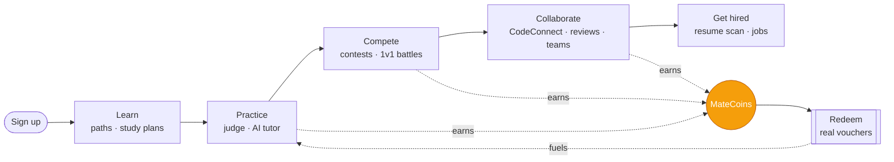
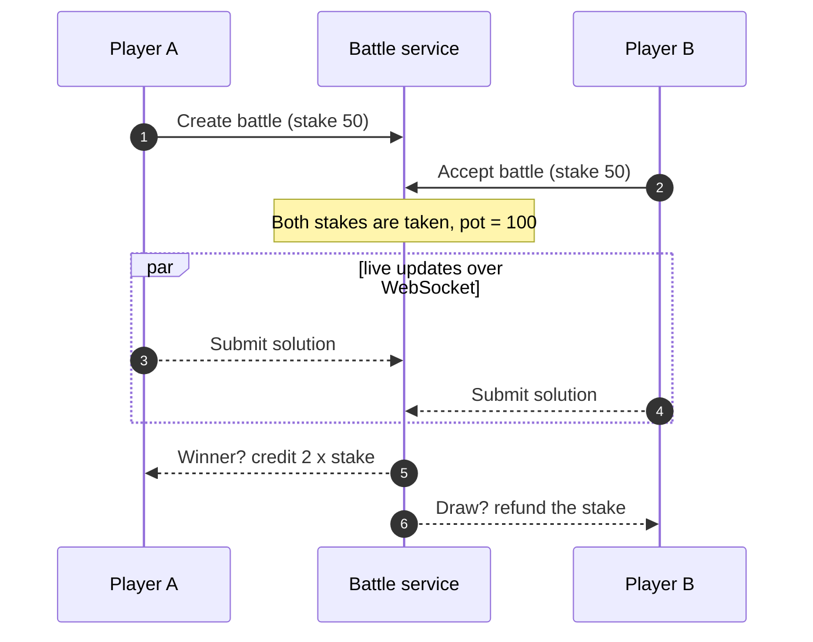

<div align="center">


<br>


**[Live site](https://compilemate.in)** &nbsp;·&nbsp; **[Features](#-features)** &nbsp;·&nbsp; **[Architecture](#-architecture)** &nbsp;·&nbsp; **[Quick start](#-quick-start)** &nbsp;·&nbsp; **[Deploy](#-deployment)**

</div>


## ✨ See it move

<div align="center">


<sub>A 25-second highlight reel. Judge, battles, CodeConnect and the rewards loop, cut from the full product film.</sub>

</div>


## 🧭 What is CompileMate?

A competitive-programming platform that covers the **whole developer journey** in one product: learn, practice, compete live, pair-program, get hired, and get paid back in real rewards.

<table>
<tr>
<td width="33%" valign="top">

### 🎯 Practice
A sandboxed code judge, AI hints that guide without spoiling, learning paths, and certificates anyone can verify.

</td>
<td width="33%" valign="top">

### ⚔️ Compete
Rated contests, live leaderboards, and 1v1 battles where both players stake MateCoins and the winner takes the pot.

</td>
<td width="33%" valign="top">

### 🪙 Earn
Every solve, streak and win earns **MateCoins**, redeemable for real vouchers from brands like Zomato, Amazon, Uber, Swiggy and Steam.

</td>
</tr>
</table>



<div align="center">

<sub>Scale figures are counted from this repository (excluding migrations, <code>venv</code> and collected static files).</sub>
</div>


## 🚀 Features

### 🎯 Code judge



| | |
|---|---|
| **Languages** | Python, Java, C++ and JavaScript. A server-side harness wraps your function, so you only write the solution. |
| **Execution** | A Docker-based sandboxed executor (compile-once), with Judge0 as an alternative backend. |
| **Feedback** | Per-test-case status, runtime and memory, plus custom input. |
| **Content** | A growing problem library plus company-wise problem sets. |

<details>
<summary><b>🤖 AI tutor: hints, not answers</b></summary>
<br>

Three levels of progressive hints (gentle, moderate, detailed), plus **explain my error**, **review my code**, **suggest test cases** and an **AI problem generator**. AI calls are capped per user per day.

</details>

### ⚔️ 1v1 battles


Both players put MateCoins at stake when they enter. Progress streams over WebSockets. The winner receives the pot (2× the stake); a draw refunds both stakes; a cancelled battle refunds the challenger.



<details>
<summary><b>🏟️ Contests and leaderboards</b></summary>
<br>

Timed, rated rounds with per-problem scoring, a live leaderboard, contest announcements, and team contests.

</details>

### 🔥 Habits that bring people back


- **Daily challenge** with bonus MateCoins and XP.
- **Streaks** with purchasable **streak freezes**, so one missed day doesn't erase progress.
- **Badges** across six tiers: Bronze, Silver, Gold, Platinum, Diamond, Legendary. Plus achievements and milestones.

### 📚 Learn and certify



Learning paths (modules, enrollment, ratings, editorials), structured **study plans**, **skill assessments**, and **PDF certificates** with a public verification page.

### 🎥 CodeConnect: pair-program live



Rooms with **WebRTC video** (signaling over WebSockets), a shared **Monaco** code editor, a **whiteboard** and room chat.

### 🤝 Community


**Teams** with roles, invitations, team XP and team contests. A **social feed** with posts, comments, follows and activity. **Peer code reviews** with line comments, ratings and reviewer stats. A **snippet library** with tags, collections and comments.

### 💼 Career tools



**Resume scanner** with ATS and keyword scoring, a **job board** with companies, postings and application tracking, **company-wise problems**, and **recruiter profiles with coding challenges**.

### 🪙 Rewards economy


Earn rates shown on the site: Easy **+50**, Medium **+150**, Hard **+300**, Contest win **+1000**. Redeem for vouchers, plus daily rewards, referral rewards and promo codes.

### 🎉 Built to be shared



**Coder Wrapped**, **Roast My Code**, a developer personality quiz, a coding horoscope, dev bingo and a tier list: small share-worthy loops that bring new people in.


## 🏗 Architecture


- **HTTP** is served by Gunicorn (WSGI). **WebSockets** (battles, CodeConnect signaling, live support chat) run on Django Channels under ASGI with Daphne.
- **Redis** backs the cache, the Channels layer and the Celery broker. Without `REDIS_URL` the app falls back to in-memory backends for local development.
- **Celery** (worker + beat) runs scheduled and async work.

<details>
<summary><b>Tech stack</b></summary>
<br>

| Layer | Tools |
|---|---|
| Backend | Django 4.2, Django REST framework, django-allauth (Google and GitHub), django-otp (2FA), django-filter |
| Real-time | Django Channels, channels-redis, Daphne, WebRTC |
| Data | PostgreSQL, Redis, django-cacheops |
| Async | Celery, django-celery-beat, django-celery-results |
| Frontend | Tailwind CSS, HTMX, Alpine.js, Monaco Editor |
| Judge | Docker sandbox executor, Judge0 API |
| AI | OpenAI (tutor and problem generator) |
| Docs and PDF | ReportLab (certificates), PyPDF2, python-docx |
| Ops | Whitenoise, Docker, Render |

</details>

<details>
<summary><b>Project layout</b></summary>
<br>

```text
compilemate/          settings, ASGI/WSGI, Celery
core/                 home, dashboard, profile, AI tutor, support chat, notifications
problems/  judge/     problems, submissions · sandbox executor, Judge0, language harness
contests/  battles/   rated contests · 1v1 battles (WebSocket consumer)
daily_challenges/     daily challenge, streaks, streak freezes
achievements/         badges (6 tiers), achievements, milestones
learning_paths/       paths, modules, editorials   study_plans/  certifications/
collaboration/        CodeConnect rooms, WebRTC signaling
teams/ social_feed/ code_reviews/ snippets/        community
jobs/ resume_scanner/ company_problems/            career
rewards/              vouchers, promo codes, daily and referral rewards
fun/                  Wrapped, Roast My Code, quiz, horoscope, bingo, tier list
users/ theme/         accounts, coins · Tailwind theme
templates/ static/    112 templates · PWA manifest and service worker
```

</details>


## ⚡ Quick start

**Prerequisites:** Python 3.11+, PostgreSQL 15 (or Docker). Redis is optional locally.

```bash
git clone https://github.com/Compile-Mate/Compile-Mate.git
cd Compile-Mate

python3 -m venv venv && source venv/bin/activate
pip install -r requirements.txt
```

Create a `.env` file in the project root:

```env
SECRET_KEY=change-me
DEBUG=True
DB_NAME=compilemate_db
DB_USER=postgres
DB_PASSWORD=your-password
DB_HOST=localhost
DB_PORT=5432
```

```bash
python manage.py migrate
python manage.py createsuperuser
python manage.py seed_content        # problems, paths, assessments, badges, FAQ (idempotent)
python manage.py runserver           # http://127.0.0.1:8000
```

<details>
<summary><b>Optional environment variables</b></summary>
<br>

| Variable | Enables |
|---|---|
| `DATABASE_URL` | Single-URL database config (used on Render) |
| `REDIS_URL` | Redis cache, Channels layer and Celery broker |
| `OPENAI_API_KEY` | AI tutor and problem generator |
| `JUDGE0_API_URL`, `JUDGE0_API_KEY` | Judge0 execution backend |
| `GOOGLE_CLIENT_ID`, `GOOGLE_CLIENT_SECRET` | Google sign-in |
| `GITHUB_CLIENT_ID`, `GITHUB_CLIENT_SECRET` | GitHub sign-in |
| `EMAIL_HOST`, `EMAIL_PORT`, `EMAIL_HOST_USER`, `EMAIL_HOST_PASSWORD` | Outgoing email |

</details>

<details>
<summary><b>🐳 Run everything with Docker Compose</b></summary>
<br>

```bash
docker compose up --build
```

Starts PostgreSQL 15, Redis 7, the web app, a Celery worker and Celery beat.

</details>

<details>
<summary><b>🧪 Tests and handy commands</b></summary>
<br>

```bash
pytest                                      # pytest + pytest-django (see pytest.ini)
python manage.py check_system               # system health check
python manage.py seed_content --dry-run     # preview content changes, then roll back
python manage.py seed_problems              # sample problem set
python manage.py generate_promo_codes       # rewards promo codes
python manage.py clear_cache
```

</details>

## 🌍 Deployment

- **Render:** `render.yaml` + `build.sh` (install, `collectstatic`, `migrate`, `createcachetable`) with a managed PostgreSQL database.
- **Docker:** `Dockerfile` runs Gunicorn; `docker-compose.yml` adds Postgres, Redis and Celery for local parity.
- **WebSockets in production:** run an ASGI server so battles, CodeConnect and live chat work, for example `daphne -b 0.0.0.0 -p 8000 compilemate.asgi:application`.

## 🔐 Security

Google and GitHub sign-in via allauth, optional two-factor authentication, Django's CSRF protection, custom **rate-limiting** and **security-header** middleware, and per-user daily limits on AI calls.

<br>


<div align="center">
<sub>The previous long-form README is kept at <a href="docs/README.legacy.md">docs/README.legacy.md</a>.</sub>
</div>
